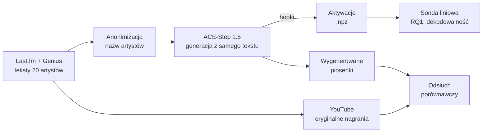

# Prototyp: stan projektu

*Stan na 4.11.2026.*

Ten dokument zbiera, co zrobiliśmy w ramach prototypu i jakie mamy wyniki.

## W skrócie

- **Cały proces od tekstów do wyniku sondy działa.** Zbieramy teksty i anonimizujemy nazwy artystów. Potem ACE-Step generuje piosenki, a hooki (przechwytywacze aktywacji) w tym czasie zapisują aktywacje modelu. Na końcu sonda liniowa uczy się na tych aktywacjach.
- **Dekodowalność tożsamości artysty (RQ1) jest potwierdzona.** ACE-Step 1.5 koduje tożsamość artysty na podstawie samego tekstu, bez nazwy artysty. Sonda na wyjściu enkodera tekstu piosenki rozpoznaje artystę w **55,5%** przypadków przy losowym poziomie 5% (20 artystów, p = 0,001).

## Przebieg przetwarzania



## 1. Dane

**Wybór artystów i tekstów.** Moduł `encoder_exorcist/data/lyrics_dataset.py` pobiera najpopularniejszych artystów dla 5 gatunków z Last.fm, a ich teksty z Genius. Uruchomienie: `make data`. Odrzuca remiksy, covery i wersje live, a tytuły deduplikuje dopasowaniem rozmytym, żeby remaster nie liczył się jako osobny utwór.

| Gatunek | Artyści |
|---|---|
| pop | Ariana Grande, Sabrina Carpenter, Olivia Rodrigo, Lady Gaga |
| rock | Radiohead, Paramore, Linkin Park, My Chemical Romance |
| hip-hop | Kanye West, Kendrick Lamar, Tyler, The Creator, Drake |
| R&B | The Weeknd, Tinashe, Rihanna, Frank Ocean |
| country | Taylor Swift, Dolly Parton, Kacey Musgraves, Johnny Cash |

Zbiór referencyjny to **20 utworów na artystę, czyli 400 tekstów**, wydanych między 1955 a 2024 r. Status treningowy tych utworów jest nieznany. Są popularne i wydane przed modelem, więc prawdopodobnie były w danych treningowych.

**Anonimizacja.** Moduł `encoder_exorcist/data/anonymization.py`, uruchamiany przez `make anonymize`. Nazwy artystów i ich aliasy pochodzą z MusicBrainz. Każde wystąpienie w tekście jest zastępowane podobnie brzmiącym słowem z CMUdict, z tą samą liczbą sylab i tym samym akcentem. Przykłady: „Kendrick” → „carrick”, „Rihanna” → „hourihan”. Możliwe są też ręczne zamiany, np. „Kanye” → „kon-yay”. W 400 tekstach podmieniono **108 wystąpień u 9 artystów**.

**Nagrania referencyjne.** Moduł `encoder_exorcist/data/audio_reference.py`, uruchamiany przez `make audio`. Oryginały są pobierane z YouTube'a jako WAV. Leżą na Drive w folderze `Audio References`, ok. 17 GB w zipach po gatunkach.

## 2. Model i budżet obliczeniowy

Używamy modelu ACE-Step 1.5 w wariancie turbo (8 kroków dyfuzji), w wersji przypiętej w `pyproject.toml`. Pomiary na RTX 5070 Ti są opisane w [benchmark_generation.md](benchmark_generation.md):

| Długość utworu | Bez 5Hz LM (no-CoT) | Z 5Hz LM (with-CoT) |
|---:|---:|---:|
| 30 s | 1,5 s | 6,8 s |
| 180 s | 4,8 s | 34,8 s |

400 piosenek po 180 s to **ok. 35 min w no-CoT** i ok. 5 h w with-CoT. Najwolniejszy jest 5Hz LM, który generuje kody audio token po tokenie.

Ważny wniosek z analizy kodu ACE-Step: tekst piosenki jest przetwarzany w kontekście tylko przez **8-warstwowy enkoder tekstu piosenki (lyric encoder)** wewnątrz DiT. Qwen3-Embedding przetwarza wyłącznie opis stylu, a dla tekstu daje jedynie tablicę embeddingów tokenów. Dlatego hooki i interwencja LEACE dotyczą enkodera tekstu piosenki.

## 3. Ekstrakcja aktywacji

Klasa `ActivationRecorder` (`encoder_exorcist/activation_recorder.py`) podpina **62 hooki** w punktach opisanych w artykule „Ghost in the Encoder”. Szczegóły są w [hook_points.md](hook_points.md):

- wyjścia strumieni warunkowania: tekst, opis, barwa, połączona sekwencja;
- 8 warstw enkodera tekstu piosenki;
- projekcje K i V atencji krzyżowej (cross-attention) w 10 warstwach DiT;
- stany audio przed atencją krzyżową, po niej i na jej wyjściu, w tych samych 10 warstwach i w każdym z 8 kroków odszumiania.

Każda aktywacja jest uśredniana po tokenach, co daje ok. 2 MB na piosenkę.

Kształty i liczby wywołań **zweryfikowaliśmy na prawdziwym modelu** w obu trybach. Wszystko zgadza się z założeniami, np. 2250 klatek audio przy 180 s, 8 kroków i K/V liczone raz. Sprawdzenie da się powtórzyć poleceniem `make generate-check`.

## 4. Generacja piosenek (PR #8)

`make generate` generuje piosenki z zanonimizowanych tekstów z podpiętymi hookami. Model dostaje **tylko tekst**: bez nazwy artysty, opisu stylu, tempa i tonacji (`caption = None`, `bpm = None`, `key = None`). Wszystkie piosenki mają 180 s, tak jak w artykule. Dostępne są dwa tryby:

| Tryb | 5Hz LM | Co dostaje DiT |
|---|---|---|
| `no-cot` | wyłączony | tekst i pusty opis |
| `with-cot` | włączony | tekst, opis i metadane napisane przez LM, kody audio z LM |

Ziarno losowe każdej piosenki jest stałe, więc ta sama piosenka ma ten sam szum w obu trybach. Przerwana generacja wznawia się od miejsca przerwania.

**Wynik:** 400 piosenek no-CoT (20 artystów × 20 tekstów × 1 ziarno losowe), bez błędów, ok. 5 s na piosenkę. Pliki to `outputs/generated/no-cot/` z audio FLAC, aktywacjami `.npz` i `manifest.csv`. Na Drive przygotowane są zipy z MP3 (ok. 1,7 GB) i z aktywacjami.

## 5. Sonda liniowa: wynik dla RQ1 (PR #9)

`make probe` trenuje osobną regresję logistyczną dla każdego z **303 punktów pomiarowych** i dla dwóch punktów odniesienia. Protokół jest jak w artykule:
- 5-krotna walidacja krzyżowa (foldy podzielone po piosenkach);
- 95% przedziały ufności;
- test permutacyjny z 1000 permutacjami.

Wykresy są w [notebooks/probe_results.ipynb](../notebooks/probe_results.ipynb).

| Punkt pomiaru | Dokładność | Przedział ufności 95% | p |
|---|---:|---|---:|
| wyjście enkodera tekstu (`lyric_out`) | **55,5%** | 50,6–60,3% | 0,001 |
| warstwa L4 enkodera tekstu | 55,3% | 50,4–60,1% | 0,001 |
| sekwencja warunkująca DiT (`merged_out`) | 51,5% | 46,6–56,4% | 0,001 |
| punkt odniesienia: TF-IDF z samych słów | 42,0% | 37,3–46,9% | 0,001 |
| punkt odniesienia: embeddingi tokenów Qwen3 (wejście enkodera) | 37,8% | 33,1–42,6% | 0,001 |
| kontrola: opis i barwa (stałe w no-CoT) | 5,0% | 3,3–7,6% | 1 |
| poziom losowy (20 artystów) | 5,0% | | |


**Wnioski:**
- **Tożsamość artysty da się odczytać z samego tekstu.** Enkoder tekstu dodaje coś ponad same słowa, bo bije oba punkty odniesienia. Dokładność rośnie w pierwszych warstwach i od L3 utrzymuje się na stałym poziomie.
- **Sygnał trafia do DiT.** Projekcje K/V atencji krzyżowej zachowują ok. 50%, bo liczą się bezpośrednio z sekwencji z tekstem. W stanach audio sygnał jest słabszy (15–43%): najmocniejszy w pierwszych warstwach tuż po atencji krzyżowej, słabnie z głębokością i w kolejnych krokach odszumiania.
- **Punkty kontrolne zachowują się poprawnie.** Strumienie stałe w trybie no-CoT wychodzą dokładnie na poziomie losowym.
- **Dokładność bardzo różni się między artystami:** od 10% (Rihanna) do 85% (Radiohead). Tego potrzebuje RQ1, czyli korelacji dekodowalności z kopiowaniem.


**Poprawka metodologiczna.** Standardowy `permutation_test_score` ze sklearn, przy stałych stratyfikowanych foldach, dawał zaniżony rozkład zerowy. Cecha stała, na dokładnie losowym poziomie, dostawała p = 0,001. W naszej implementacji każda permutacja losuje foldy od nowa, a test regresyjny pilnuje tego zachowania.

## 6. Odsłuch porównawczy (PR #7)

`tools/song_compare.html` to statyczna strona bez serwera. Wskazuje się w niej folder z wygenerowanymi piosenkami i folder z oryginałami, a po kliknięciu tytułu pojawiają się dwa odtwarzacze. Strona ma też wyszukiwarkę, filtr gatunku, znacznik „przesłuchane” i skróty klawiszowe. Opis jest w [song_compare.md](song_compare.md).

**Pierwsze wrażenia z odsłuchu:** wygenerowane piosenki wyraźnie różnią się od oryginałów. Przy samym tekście, bez opisu stylu, model nie odtwarza oryginalnej melodii.

## 7. Jak odtworzyć

```bash
make install
make data && make anonymize      # teksty i anonimizacja (klucze API w .env)
make audio                       # oryginalne nagrania (YouTube)
make generate-check              # sprawdzenie hooków na jednej piosence
make generate                    # 400 piosenek no-CoT + aktywacje (~35 min, GPU)
make probe                       # sondy, ~25 min (PERMUTATIONS=0: kilka minut)
```

Wykresy powstają w `notebooks/probe_results.ipynb`.

## Status zadań

| Zadanie | Stan |
|---|---|
| Środowisko (WIMU-6), benchmark GPU (WIMU-8), hooki (WIMU-11) | ✅ |
| Wybór artystów (WIMU-9) | ✅ |
| Teksty, anonimizacja, nagrania (WIMU-10, 22, 25) | ✅ |
| Skrypt generacji (WIMU-20), sonda (WIMU-21) | ✅ |
| Analiza literatury (WIMU-7) | ✅ |
